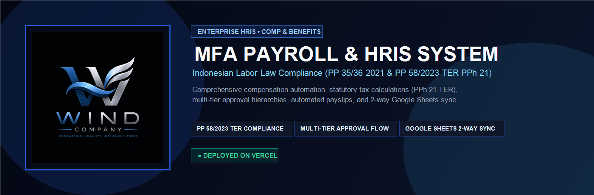

<div align="center">



# MFA PAYROLL &bull; ENTERPRISE HRIS PLATFORM
### Statutory Labor Law Compliance &bull; Compensation Automation &bull; Multi-Tier Governance

[](https://pay-roll-theta.vercel.app)
[](https://pay-roll-theta.vercel.app)
[](https://pay-roll-theta.vercel.app)
[](https://github.com/faarimuhammad2502)

<br>

**AN INTEGRATED HUMAN RESOURCE INFORMATION SYSTEM (HRIS) & STATUTORY PAYROLL ENGINE**  
*Conceived, architected, and engineered by Muhammad Faari Akbar*

[Access Live Enterprise Portal](https://pay-roll-theta.vercel.app) &bull; [Inspect Source Repository](https://github.com/faarimuhammad2502/payroll)

</div>

---

## EXECUTIVE SUMMARY

**MFA Payroll & HRIS** is an enterprise-grade web application engineered to automate corporate compensation, employee master data management, and statutory Indonesian labor law compliance. 

Designed by merging **Human Resource Management, Labor Regulations, and Financial Data Analytics**, the platform eliminates payroll processing inaccuracies, mitigates non-compliance legal risks, and provides complete auditable governance. The system handles complex wage structures, overtime formulas, non-permanent contract compensations, and personal income tax withholding with zero external software bloat.

---

## STATUTORY REGULATORY COMPLIANCE ENGINES

MFA Payroll is built with native calculation matrices strictly aligned with Indonesian Ministry of Finance and Ministry of Manpower regulations:

### 1. PPh 21 TAX COMPUTATION &bull; PP 58/2023 (TER SCHEME)
* **Average Effective Tax Rate (Tarif Efektif Rata-Rata - TER):** Automated bracket assignment across Categories A, B, and C based on employee non-taxable income status (*PTKP: TK/0 through K/3*).
* **Monthly Withholding & Annual True-Up:** Precise monthly deductions (January–November) coupled with December tax reconciliations to prevent employer under/over-withholding.

### 2. EMPLOYMENT REGULATION COMPLIANCE &bull; PP 35/2021 & PP 36/2021
* **PKWT Contract Compensation Calculator:** Statutory end-of-contract gratuity calculations proportional to tenure for fixed-term employees.
* **Religious Holiday Allowance (THR):** Prorated and full entitlement engines factoring tenure, basic salary, and fixed allowances.
* **Termination & Severance Calculator (PHK):** Formulaic assessment of severance pay (*UP*), service appreciation pay (*UPMK*), and compensation rights (*UPH*).
* **Statutory Overtime Matrix:** Standardized hourly multiplier formulas (1.5x initial hour, 2.0x subsequent weekday hours, up to 3.0x/4.0x holiday rates).

### 3. STATUTORY WAGE STRUCTURE & SCALE &bull; PERMENAKER NO. 1 TAHUN 2017
* **Official Wage Scale Reference Matrix:** Integrated matrix of 29 benchmark roles across 5 departments (Engineering, Design, Finance, Marketing, HR & Operations) mapping job grades (Grade 1-5), job levels, and salary ranges.
* **Mandatory 75% Basic Wage Rule (Pasal 94 UU 13/2003):** Strict compliance engine ensuring the basic wage component constitutes >= 75% of total fixed compensation.
* **Auto-Nominal Salary Population:** Instant cascading dropdown between department and role, automatically populating official statutory benchmark wages and overtime rates (TUL 1/173).

### 4. CORPORATE BANK DISBURSEMENT ENGINE (OPSI A)
* **BCA KlikBisnis Payroll Format:** Instant export of standard corporate payroll CSV files formatted directly for BCA KlikBisnis / myBCA Bisnis upload (`No Rekening,Nama Penerima,Nominal,Berita,Kode Bank`).
* **Mandiri Cash Management (MCM) Format:** Native batch format compliant with Bank Mandiri MCM corporate bulk transfer gateway (`Beneficiary Account Number,Beneficiary Name,Amount,Currency,Remark 1,Remark 2,Beneficiary Bank`).
* **Universal Corporate Gateway:** Standardized CSV schema with complete employee identification, bank routing, net take-home pay, and audit metadata compatible with BNI Direct, BRI Cash Management, and external payroll gateways.

### 5. STATUTORY LEAVE & CASH ADVANCE (KASBON) MANAGEMENT (OPSI B)
* **Leave & Absence Governance:** Distinct accounting between statutory paid leave (*Cuti Tahunan* 12 days/year & *Sakit/Izin Resmi* backed by medical certificates) which retains full base compensation, versus unauthorized absence (*Alpha/Mangkir*) governed by statutory deduction formulas under PP 36/2021.
* **Employee Loan & Cash Advance Installment:** Integrated tracking of employee loan balances (*Saldo Kasbon*) and automated monthly installment deduction (*Cicilan Kasbon*), with smart auto-capping (`Math.min(cicilan, saldo)`) and transparent itemization on corporate payslips and payroll ledgers.

---

## MULTI-TIER CORPORATE APPROVAL WORKFLOW

To prevent unauthorized salary modifications and uphold internal financial audit integrity, the platform implements a structured three-tier payroll release pipeline:

```
[ Tier 1: HR Specialist ]
Compilation of Master Attendance, Overtime, & Deductions
(Prepared by: Muhammad Faari Akbar)
         │
         ▼
[ Tier 2: Finance Manager ]
Budgetary Variance Review, Cash Flow Reconciliation, & Audit Verification
         │
         ▼
[ Tier 3: Managing Director / C-Suite ]
Final Executive Authorization & Banking Disbursement Release
```

Each transaction state is timestamped, locked against edits post-submission, and archived for corporate reporting.

---

## CORE SYSTEM CAPABILITIES

### EMPLOYEE MASTER DATA & BANK DISBURSEMENT
Centralized repository tracking full employee lifecycle data: employment type (*PKWT, PKWTT, Internship*), department taxonomy, base remuneration packages, tax classification (*PTKP*), and banking routing codes (BCA, Mandiri, BRI, BNI, BSI, CIMB Niaga, Permata, Jago, SeaBank).

### DYNAMIC PAYROLL PERIODS & 1-CLICK BACKUP
* **Dynamic Month & Year Picker:** Seamlessly shift between payroll periods (`YYYY-MM`) with auto-reconciled dates, approval titles, payslip headers, and report filenames.
* **1-Click JSON Backup & Restore:** Export complete offline snapshots of employees, attendance, settings, and scale matrices in encrypted/auditable JSON format, with one-click full system restore.

### DIGITAL PAYSLIP & AUTOMATED PRINT ENGINE
* Dynamic generation of professional, corporate-branded payslips with itemized gross earnings, statutory deductions, tax withholdings, and net payable compensation.
* Print-optimized layout with digital audit verification markers and print-ready CSS formatting.

### BI-DIRECTIONAL CLOUD INTEGRATION
* Seamless two-way synchronization with enterprise Google Sheets spreadsheets via REST endpoints, allowing organizations to maintain centralized spreadsheet backups without manual data entry.

---

## TECHNICAL SPECIFICATIONS & ARCHITECTURE

The platform is designed to provide maximum execution performance and zero latency:

* **Client Engine:** Modular ES6+ JavaScript, Semantic HTML5 layout, and Tailwind CSS.
* **Computation Engine:** In-browser floating-point rounding precision ensuring zero rupiah discrepancies across bulk employee batches.
* **Data Storage:** Local persistent caching with cloud-level backup synchronization.
* **Hosting Infrastructure:** Globally deployed and distributed via Vercel Edge Network.

---

<div align="center">

```
M F A   P A Y R O L L   &   H R I S   E N T E R P R I S E
ACCURACY &bull; STATUTORY COMPLIANCE &bull; AUDITABLE INTEGRITY
```

<sub>&copy; 2026 MFA Payroll. Conceived, designed, and developed by <b>Muhammad Faari Akbar</b>. All rights reserved.</sub>

</div>
